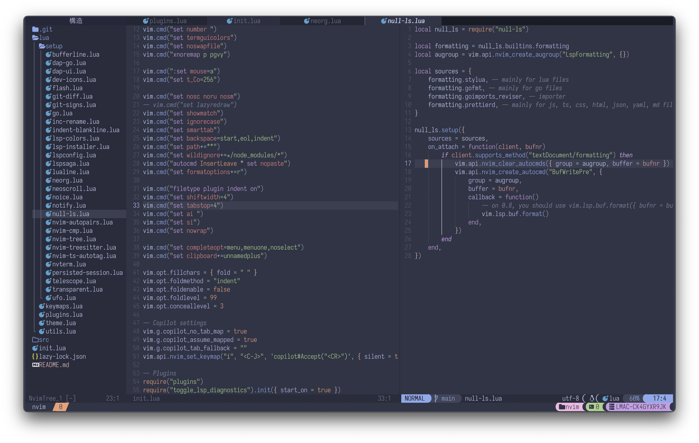

# Neovim configuration

Personal Neovim setup: Lua only, [lazy.nvim](https://github.com/folke/lazy.nvim)
for plugins, [mason.nvim](https://github.com/mason-org/mason.nvim) for LSP
servers and debug adapters, catppuccin-frappe for colors.

Daily languages are **Go, Rust, C/C++, Python, TypeScript and Lua**, each with
LSP, treesitter, format-on-save, DAP debugging and a neotest runner.



## Requirements

- **Neovim ≥ 0.11** — the config uses `vim.lsp.config()` / `vim.lsp.enable()`,
  `vim.diagnostic.jump()` and the `main` branch of nvim-treesitter.
- **A Nerd Font** in the terminal — statusline, tabline, file tree and
  completion menu all use glyphs.
- **git** and a **C compiler** — lazy.nvim bootstraps itself, treesitter
  compiles parsers.
- **ripgrep** — telescope's live grep depends on `rg`.

## Install

```sh
git clone <this repo> ~/.config/nvim
nvim
```

On first launch lazy.nvim clones itself, installs the plugins and mason pulls
its packages. Treesitter parsers compile in the background; a second launch
gives a clean start.

Nothing in `~/.config/nvim` is machine-specific except `lazy-lock.json`, which
pins every plugin commit — delete it before `:Lazy sync` if you want to move to
current upstream.

## External tools

Mason installs these automatically on first launch, no action needed:

| Kind        | Packages                                                         |
| ----------- | ---------------------------------------------------------------- |
| LSP servers | `gopls`, `clangd`, `rust_analyzer`, `lua_ls`, `yamlls`, `jsonls`, `ts_ls` |
| Formatters  | `goimports`, `clang-format`                                       |
| Debug       | `codelldb` (Rust/C/C++)                                           |

These have to come from the host, because they are toolchain-coupled or mason
does not ship them:

```sh
# Fedora — adapt the package manager for other distros
sudo dnf install ripgrep fd-find bat plocate trash-cli
sudo dnf install rust-src rustfmt clippy      # see "Rust" below

npm  install -g @fsouza/prettierd             # JS/TS/JSON/YAML/Markdown formatting
cargo install stylua cargo-nextest            # Lua formatting, Rust test runner
go   install github.com/go-delve/delve/cmd/dlv@latest   # Go debugging
pip  install debugpy                          # Python debugging
curl -LsSf https://astral.sh/ruff/install.sh | sh       # Python lint + format
```

`fd`, `bat` and `plocate` are what keep telescope snappy — it degrades to slower
fallbacks without them. `trash-cli` backs nvim-tree's delete action.

## Layout

```
init.lua                  loads the three config modules, nothing else
lua/config/
  options.lua             vim.opt settings, clipboard workaround, one autocmd
  lazy.lua                lazy.nvim bootstrap + global diagnostic config
  keymaps.lua             every global keymap (plugin-local ones live with the plugin)
lua/plugins/
  lsp/                    lspconfig, mason, none-ls (formatting), inc-rename
  completion/             blink.cmp, neocodeium (AI ghost text)
  treesitter/             parser list + per-filetype highlight/indent/folds
  debug/                  nvim-dap, dap-ui, neotest
  git/                    gitsigns, diffview, fugitive
  ui/                     catppuccin, lualine, bufferline, indent-blankline, transparent
  editor/                 telescope, nvim-tree, flash, mini.nvim, persistence, neoscroll
  lang/                   go.nvim, gen.nvim (Ollama)
```

Every directory under `lua/plugins/` is imported as a group in
`lua/config/lazy.lua`, so a new plugin is just a new file returning a lazy spec.

## Keymaps

The leader key is left at its default, **`\`**. Most bindings are two-letter
sequences in normal mode rather than leader chords.

### Navigation and windows

| Key            | Action                             |
| -------------- | ---------------------------------- |
| `s` / `S`      | flash jump / flash treesitter jump |
| `wh` `wj` `wk` `wl` | move to window left/down/up/right |
| `wp`           | close window                        |
| `vs`           | vertical split with previous buffer |
| `<C-h>` / `<C-l>` | previous / next buffer           |
| `bh` / `bl`    | move buffer left / right in tabline |
| `<C-p>`        | delete buffer                       |
| `<C-n>`        | toggle file tree                    |
| `<C-f>`        | reveal current file in tree         |
| `\n`           | refresh tree                        |
| `fn`           | clear search highlight              |

### Telescope

| Key    | Action                        |
| ------ | ----------------------------- |
| `;f`   | find files                    |
| `;r`   | live grep                     |
| `;;`   | grep word under cursor        |
| `\\`   | help tags                     |
| `fd`   | LSP definitions               |
| `fo`   | LSP references                |

Inside a picker, `<Esc>` (insert) or `q` (normal) closes it.

### LSP

| Key         | Action                                            |
| ----------- | ------------------------------------------------- |
| `K`         | hover                                             |
| `gd` / `<C-k>` | go to definition                               |
| `gD` / `gi` | go to declaration / implementation                |
| `ca`        | code action                                       |
| `rn`        | rename (inc-rename, live preview — type and `<CR>`) |
| `[g` / `]g` | previous / next diagnostic, opens the float        |
| `<Esc>`     | close any open float, otherwise normal `<Esc>`     |

Virtual text is off on purpose: diagnostics show as sign-column icons plus a
float on jump.

### Completion (blink.cmp)

`<C-Space>` open · `<CR>` accept · `<Tab>` / `<S-Tab>` next & previous ·
`<C-j>` / `<C-k>` scroll docs · `<C-e>` cancel.

### AI inline completion (neocodeium)

Grey ghost text ahead of the cursor, independent of the blink.cmp menu. All
insert mode, Alt-prefixed because blink owns every `<C-…>` and `<Tab>` binding.

| Key     | Action                       |
| ------- | ---------------------------- |
| `<A-f>` | accept whole suggestion      |
| `<A-w>` | accept next word             |
| `<A-a>` | accept next line             |
| `<A-e>` / `<A-r>` | next / previous suggestion |
| `<A-c>` | dismiss                      |

Run `:NeoCodeium auth` once — it opens a browser, and you paste the token back.
The free Windsurf (ex-Codeium) individual tier needs an account but no card;
the token lands in `~/.codeium` and persists across machines if you sync it.
`:NeoCodeium disable` turns it off for the session, `:NeoCodeium toggle` flips it.

Suggestions are cleared automatically whenever the blink.cmp menu opens, so the
two never render on top of each other.

### Git

| Key   | Action                          |
| ----- | ------------------------------- |
| `gb`  | blame current line              |
| `gv`  | preview hunk                    |
| `gr`  | reset hunk                      |
| `;g`  | toggle diffview                 |
| `gh`  | toggle file history             |

vim-fugitive is loaded too, so `:G`, `:Gdiffsplit`, `:GBrowse` (via rhubarb) all work.

### Debugging (nvim-dap)

| Key  | Action                     |
| ---- | -------------------------- |
| `bs` | start / continue           |
| `bb` | toggle breakpoint          |
| `bp` | continue                   |
| `bu` | step over                  |
| `bi` | step into                  |
| `bo` | step out                   |
| `bc` | stop and close the UI      |
| `bv` | toggle dap-ui              |
| `bt` | debug nearest Go test      |

dap-ui opens automatically when a session starts and closes when it ends.

### Tests (neotest)

| Key  | Action                    |
| ---- | ------------------------- |
| `tn` | run nearest test          |
| `tf` | run current file          |
| `ts` | toggle summary panel      |
| `to` | toggle output panel       |
| `tj` / `tk` | jump to next / previous failed test |

### Sessions (persistence.nvim)

Sessions save automatically on exit, one per git branch.

| Key   | Action                    |
| ----- | ------------------------- |
| `\qs` | restore session for cwd   |
| `\qS` | pick a session            |
| `\ql` | restore last session      |
| `\qd` | don't save this session   |

## Per-language notes

### Rust

`rust-analyzer` and `codelldb` come from mason, but rust-analyzer drives the
host toolchain, so these have to be installed by the distro:

```sh
sudo dnf install rust-src rustfmt clippy
```

- `rust-src` — stdlib go-to-definition and completion
- `rustfmt` — format on save; rust-analyzer shells out to it
- `clippy` — optional, only if you switch `check.command` to `"clippy"` in
  `lua/plugins/lsp/lspconfig.lua`

Rust is the one language that formats through its LSP instead of none-ls:
none-ls dropped its rustfmt source, and rustfmt on stdin can't read the edition
out of `Cargo.toml`.

Debugging uses codelldb against the compiled binary, so `cargo build` (or
`cargo test --no-run`) must run first. The launch prompt is pre-filled with
`target/debug/` — `<Tab>` completes.

Tests run through `cargo-nextest`.

### Go

`gopls` from mason, `dlv` from `go install`. go.nvim adds `:GoIfErr`,
`:GoFillStruct`, coverage signs and friends. `bt` debugs the test under the
cursor.

### C/C++

clangd works on single files out of the box. For real projects drop a
`compile_commands.json` at the root (`bear -- make`, or CMake with
`CMAKE_EXPORT_COMPILE_COMMANDS=ON`) so flags are accurate. Tests go through
neotest-gtest.

### Python

Split setup: **pyright** for types and navigation, **ruff** for linting and
formatting. Ruff's hover is disabled so pyright owns it, and pyright's own
analysis is muted so the two don't double-report. Debugging picks up
`venv/` or `.venv/` in the cwd automatically.

### TypeScript / JavaScript

`ts_ls` from mason, formatting via prettierd.

### Ollama

`gen.nvim` is installed for local models — `:Gen` against a running Ollama
instance. Not wired to a keymap.

### R2D2 (work-specific)

`lua/plugins/lsp/lspconfig.lua` registers a custom `r2d2` server built from
`~/Projects/SecOps/r2d2-lsp`. It only attaches to `r2d2-*.yml` files or anything
under `infra/r2d2/`, and does nothing at all if `~/go/bin/r2d2-lsp` is absent —
safe to leave in place, or delete the block if you don't need it.

## Gotchas

**GNOME/Wayland clipboard.** `lua/config/options.lua` forces the clipboard
through `xsel` on GNOME/Wayland. Mutter implements no data-control protocol, so
each `wl-copy` creates a real toplevel window, which tiling extensions then
tile — the screen flickers on every yank. X11 selection ownership uses an
unmapped window instead. Requires `xsel`; every other platform keeps Neovim's
own detection (pbcopy, win32yank, wl-clipboard).

**Formatting is silent.** none-ls formats on `BufWritePre` for every configured
filetype. If a formatter binary is missing, the save just doesn't format —
check `:NullLsInfo`.

**Treesitter is on the `main` branch**, which is a rewrite: `setup({ highlight
= ... })` does nothing. Highlighting, indent and folds are enabled per filetype
via `vim.treesitter.*` in `lua/plugins/treesitter/nvim-treesitter.lua`. Add a
language to `ensure_installed` there and it gets all three.

**Diagnostics are configured twice**, in `lua/config/lazy.lua` (after plugin
setup, so it wins) and in `lspconfig.lua`. The lazy.lua block is the one that
takes effect for `virtual_text` and jump behavior.

## Health check

```
:checkhealth
:Lazy
:Mason
:NullLsInfo
:LspInfo
```
